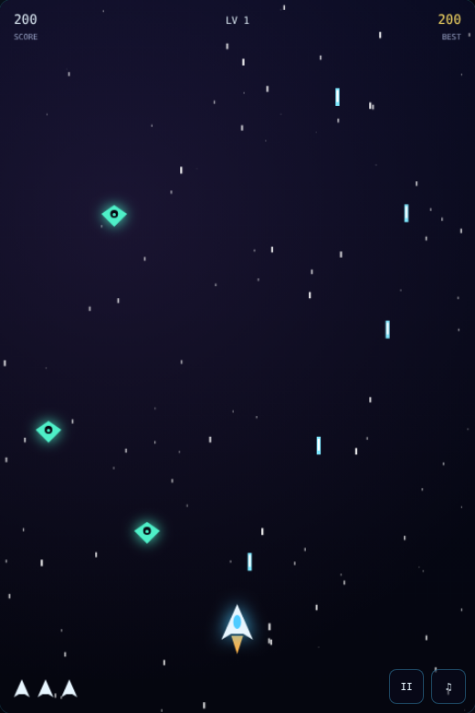

# 🚀 Astro Blaster

A fast, retro-style **space shooter** built with pure **HTML5 Canvas, CSS and vanilla JavaScript** — no frameworks, no libraries, no build step.

Fight through endless waves of enemies, grab power-ups, and take down the **Mothership** boss every 5 levels.



▶️ **Play online:** https://lochana720.github.io/astro-blaster/

---

## ✨ Features

- 🎮 Smooth 60 FPS gameplay on HTML5 Canvas
- 👾 3 enemy types (Scout, Fighter, Tank) with different movement and attack patterns
- 💀 Boss fight every 5 levels with multiple bullet patterns
- ⚡ Power-ups: **Triple Shot**, **Rapid Fire**, **Shield** and **Extra Life**
- 📈 Endless levels with increasing difficulty
- 🏆 High score saved in the browser (`localStorage`)
- 🔊 Retro sound effects generated with the Web Audio API (no audio files)
- 💥 Particle explosions, screen shake and a parallax starfield
- 📱 Works on desktop and mobile (touch controls with auto-fire)
- ⏸️ Pause, resume and mute support

## 🕹️ Controls

| Action | Keyboard | Touch / Mouse |
| ------ | -------- | ------------- |
| Move | `←` `→` `↑` `↓` or `W` `A` `S` `D` | Drag on the screen |
| Shoot | `Space` (hold) | Auto-fire while touching |
| Start / Restart | `Enter` or `Space` | Tap the button |
| Pause | `P` or `Esc` | `II` button |
| Sound on/off | `M` | `♫` button |

## 🧩 Power-ups

| Icon | Power-up | Effect |
| ---- | -------- | ------ |
| `3` | Triple Shot | Fires three bullets at once (10s) |
| `R` | Rapid Fire | Doubles the fire rate (8s) |
| `S` | Shield | Blocks one hit (8s) |
| `+` | Extra Life | +1 life (max 5) |

## 🛠️ Tech Stack

- HTML5
- CSS3 (Flexbox, Grid, animations)
- JavaScript (ES6+)
- Canvas 2D API
- Web Audio API
- localStorage

## 📂 Project Structure

```
astro-blaster/
├── index.html   # Page layout and menu screens
├── style.css    # Styling and responsive layout
├── game.js      # Game logic, rendering, input and audio
├── LICENSE
└── README.md
```

## 🚀 Run Locally

1. Clone the repository
   ```bash
   git clone https://github.com/Lochana720/astro-blaster.git
   cd astro-blaster
   ```
2. Open `index.html` in your browser.

   Or run a small local server:
   ```bash
   npx serve .
   # or
   python -m http.server 8000
   ```

## 🌐 Deploy with GitHub Pages

1. Push the project to a GitHub repository.
2. Go to **Settings → Pages**.
3. Under **Build and deployment**, choose **Deploy from a branch**.
4. Select the `main` branch and the `/ (root)` folder, then click **Save**.
5. After a minute, the game is live at `https://<your-username>.github.io/astro-blaster/`.

## 🔮 Future Improvements

- Online leaderboard
- More enemy types and boss designs
- Background music
- Gamepad support

## 👤 Author

**Lochana** — [@Lochana720](https://github.com/Lochana720)

## 📄 License

This project is licensed under the [MIT License](LICENSE).
